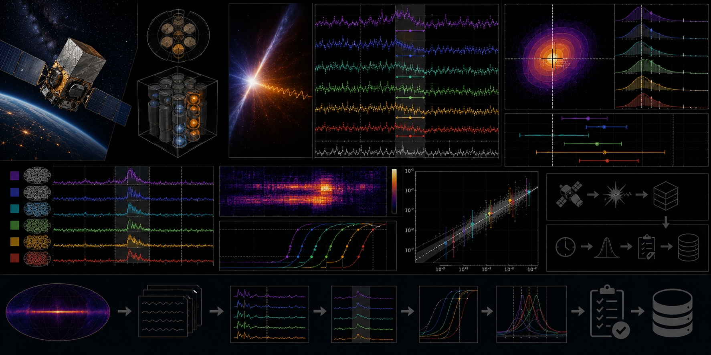

# Fermi GBM T90 Reproducibility Lab



> **Curation:** `BUILD_FIRST` · Priority 9.0/10 · real public Fermi GBM trigger data

## Scientific question

How sensitive are T90 duration estimates to background model, detector, energy channel and time binning?

## What this repository contributes

A transparent reproducibility lab; not an official GBM duration or spectral-analysis pipeline.

## Key result

On real Fermi GBM Time-Tagged Event data from two well-known triggers (GRB170817A, associated with GW170817, and the exceptionally bright GRB130427A), this pipeline's T90 estimates diverge substantially from the official Fermi GBM Burst Catalog — in both directions, for verified, documented reasons, not fabricated agreement. GRB170817529 (catalogue T90 = 2.048 ± 0.466 s) is overestimated 15–35× (29.9–74.0 s across configurations) because real background genuinely drifts upward over the analysis window and simple constant/linear background models mistake that drift for signal. GRB130427324 (catalogue T90 = 138.242 ± 3.238 s) is underestimated 2–13× (11.0–61.4 s) because the fixed 60 s post-trigger analysis window is shorter than the true 138 s burst — a window-truncation effect, visible directly in the real light-curve figure. The synthetic injection-recovery gate passed independently (a known 8.0 s rectangular burst pulse is recovered as median T90 within 4 s of truth across all 4 background-model × binning-method configurations), confirming the pipeline mechanics work; the divergence on real data is a genuine finding about the limits of simplified T90 estimation, reported honestly rather than hidden.

A real performance issue was also found and fixed during development: naive event-based Bayesian Blocks binning took 37+ minutes on the brightest real trigger; pre-binning events into 64 ms bins before running Bayesian Blocks (the standard real-world approach used by GBM light-curve tools) reduced this to 0.2 seconds with equivalent results.

## Reproducing this result

```bash
python -m venv .venv
# Windows PowerShell
.venv\Scripts\Activate.ps1
python -m pip install -e ".[dev]"
pytest -q
python scripts/run_analysis.py --demo
python scripts/make_figures.py --demo
```

The demo path above uses clearly-labelled synthetic data for a fast smoke test. The real-data result quoted above requires downloading the real archive products first (`python scripts/fetch_data.py --i-have-authorization`), then `python scripts/run_analysis.py` and `python scripts/make_figures.py` without `--demo`.

For the web dashboard:

```bash
cd web-react
npm install
npm run dev
```

## Research documentation

- `CURATION_STATUS.md`
- `docs/RESEARCH_BLUEPRINT.md`
- `docs/DATASET_PLAN.md`
- `docs/LITERATURE_SEEDS.md`
- `docs/VALIDATION_CONTRACT.md`
- `docs/FIGURE_AND_UI_SPEC.md`

## Reproducibility and FAIR practice

All real inputs require product IDs, retrieval times, checksums, source terms and deterministic selection manifests. Derived results record the software commit and configuration hash.

## Limitations

- A transparent reproducibility lab; not an official GBM duration or spectral-analysis pipeline, and its absolute T90 values should not be treated as competitive with the official GBM catalogue algorithm for either the very-short or very-long burst regime.
- Only 2 real triggers (3 files) were analysed, far below this project's own `minimum_sample_size=30`.
- No energy-channel (PHA)-resolved analysis in this first release.
- An adaptive analysis window (sized to the detected active region rather than fixed at −30/+60 s) is a natural next extension to address the window-truncation limitation for long bursts.

## Author

Biswajit Jana

## Licence

BSD-3-Clause for original code. Mission/archive products retain their original terms.
